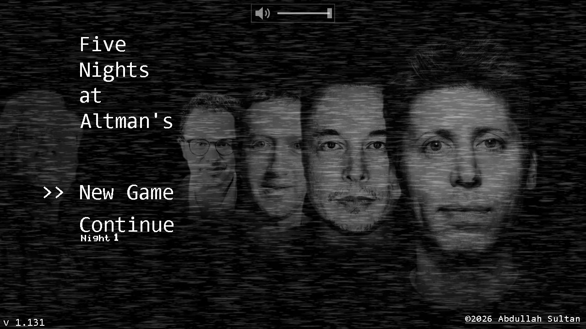
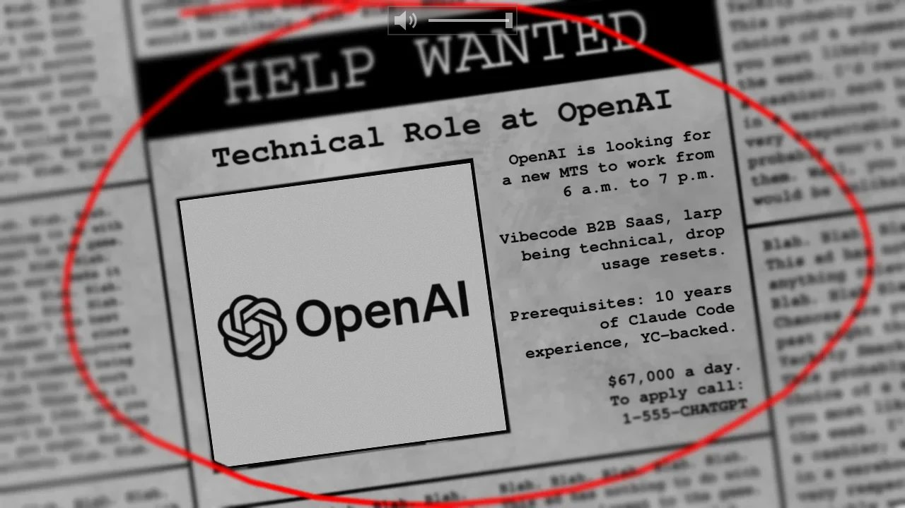
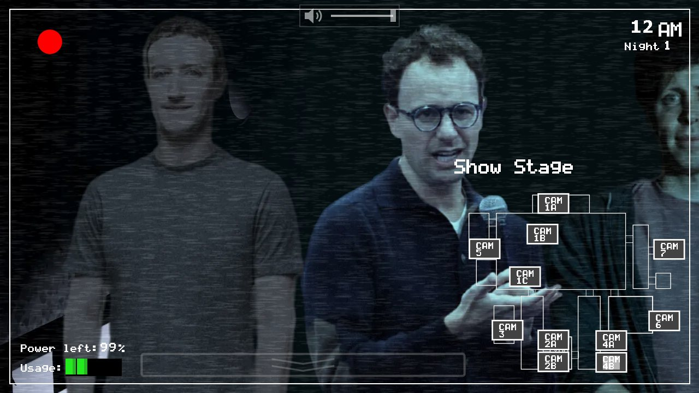
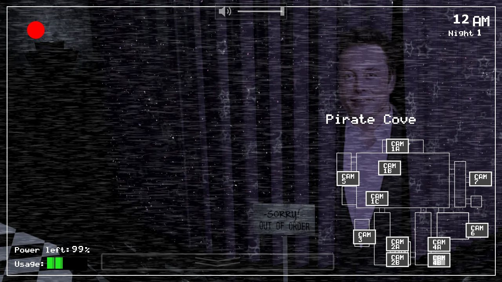
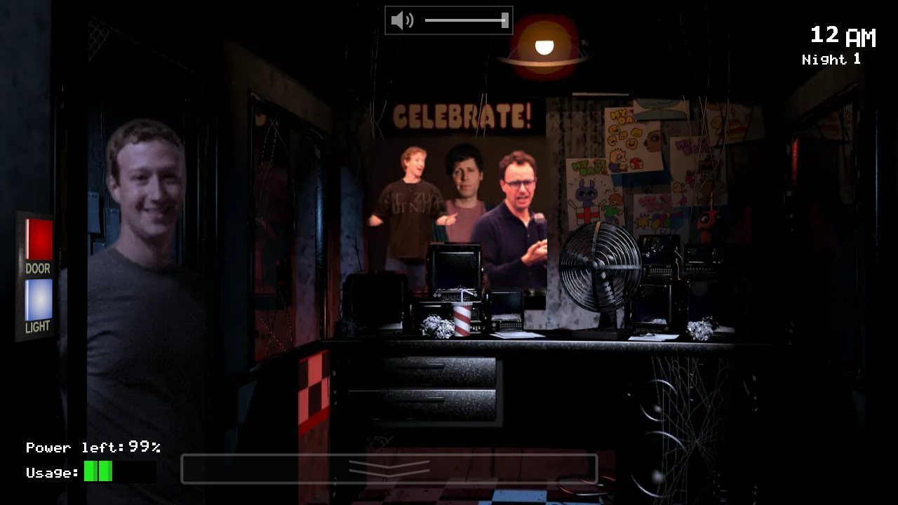
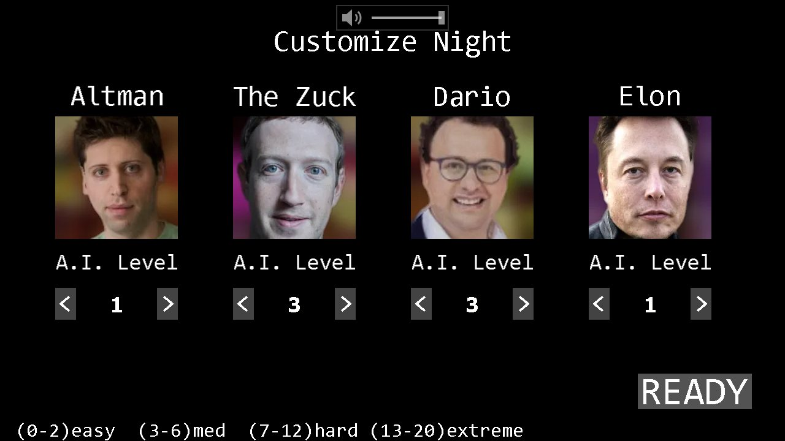

# Five Nights at Altman's

A browser parody of *Five Nights at Freddy's* where the animatronics are tech CEOs.
You've taken the night shift at OpenAI. Survive from 12 AM to 6 AM without letting
anyone into your office.



## Play

Play the game at <https://fnaa.grok.me>.

The whole game is static files, so any web server works:

```bash
git clone https://github.com/amsultan2010/five-nights-at-altmans.git
cd five-nights-at-altmans
python3 -m http.server 8000
```

Then open <http://localhost:8000>. Opening `index.html` straight from disk won't work,
since the game loads its assets with `fetch`.

## The cast

| Character | Replaces | What they do |
|---|---|---|
| **Altman** | Freddy | Starts on stage and only moves while your cameras are down. Comes for you when the power runs out. |
| **The Zuck** | Bonnie | Comes up the west hall to your **left** door. |
| **Dario** | Chica | Comes up the east hall to your **right** door. |
| **Elon** | Foxy | Waits behind the Pirate Cove curtains, then sprints down the west hall. Check on him. |
| **Jensen** | Golden Freddy | Rare. Spot his poster in the west hall corner and he may appear in your office: pull the cameras back up right away. |

## Controls

| | Computer | Phone |
|---|---|---|
| Look around the office | Move the mouse to the screen edges | Drag left / right |
| Cameras up / down | Hover the bar at the bottom | Tap the bar at the bottom |
| Switch camera | Click a camera on the map | Tap it (near misses snap to the closest) |
| Doors and lights | Click the buttons on the walls | Tap them |
| Volume | Slider at the top, or the `-` / `=` keys | Slider at the top |

Phones always play sideways. Hold yours upright and the game turns itself. On phones
that allow it (mostly Android), the first tap also goes fullscreen.

Doors, lights and cameras all drain power. Beat night 5 to unlock a 6th night, and
beat that for Custom Night.

## Screenshots

| | |
|---|---|
|  |  |
|  |  |
|  | |

## Project layout

```
index.html        the game (engine, scenes, input, audio) in one page
pcks/            images and sounds, indexed by packs/manifest.json
tools/            Python scripts that made every swapped image (see tools/README.md)
docs/             screenshots
```

The game runs from `index.html` + `packs/` alone. `tools/` is only needed to change
the art: it relights each cut-out photo to match the original frame and packs the
results back into `packs/`. A headless browser smoke test lives in `tools/tests/`.

## Credits

Made by [Abdullah Sultan](https://www.amsultan.site).

A fan parody of *Five Nights at Freddy's* by Scott Cawthon. Not affiliated with or
endorsed by Scott Cawthon or any of the people pictured. The original game's art
and audio belong to their owner; photos of public figures are used for parody.
